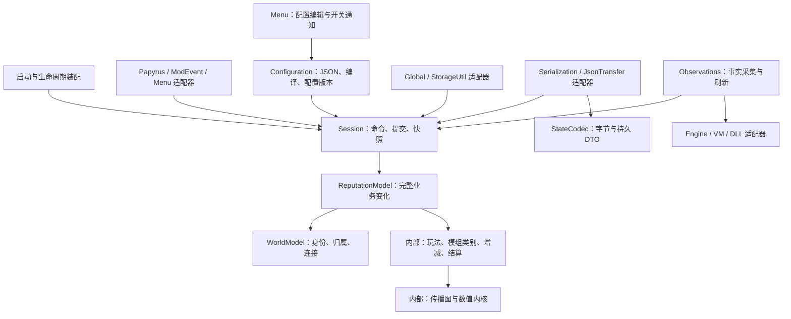

# SLSF Reloaded NG 代码库设计

更新：2026-10-28。依据[项目规格](spec.md)设计，供 A/B/C 任务实现时使用。本文确定模块职责、接口、状态归属和接入顺序；规格继续维护需求及任务状态。内部布局和选定算法按[优化实施方案](optimization-plan.md)落地。下面新增的类型与方法是设计约定，现有实现情况见“对现有代码的接入”。

## 从需求得到的分工

按需要一起完成的行为划分模块：调用方提交一条命令，模块内部执行对应规则。37 个 CPP 按任务分工，一个模块可以包含多个 CPP。

| 需求（规格中的用户故事） | 负责的模块 / 适配器 | 调用方得到的能力 |
|---|---|---|
| 1–4：查询、同步写入、事件和公开输出 | Session；Papyrus、ModEvent、LegacyOutputs 适配器 | 一次提交后读到结果，所有输出来自同一已提交版本 |
| 5–7：注册、未知、四类清理 | ReputationModel，管理模组注册和类别设置 | 一次处理模组类别变更及符合条件的清理 |
| 8、10：地点归属、独立区域、连接 | WorldModel；修改由 Session 提交 | 从实际地点找到地区声望，连接修改与当前状态保持一致 |
| 9、11、12：传播、原玩法、时间 | ReputationModel，包含玩法规则与结算 | 推进实际时间或处理观测事件，得到完整业务结果 |
| 13：P+/设备/纹身事实 | Observations；引擎与提供方 适配器 | 带 readiness 和 epoch 的自有事实 |
| 14：原生保存 | Session；Serialization / JsonTransfer 适配器 | 完整捕获、校验、绑定并激活本档业务 |
| 15：配置、菜单和转移 | Configuration；Menu / 文件 适配器，Session 消费配置 | 跨档 JSON 统一读取及通知，状态转移按独立合同执行 |
| 16：低开销执行 | 各模块的内部实现 | 调用方式保持稳定，内部使用紧凑布局、批次和缓存 |

接口说明参数、由谁保存数据、调用顺序、错误和成本。游戏采集、旧协议传输和文件读取提供可替换的测试入口；纯内存计算直接组合。

## 模块关系

箭头表示调用或代码依赖。外部异步结果通过自有消息回到 Session。

`SLSFCore` 包含 WorldModel、ReputationModel、纯规则和编码器；运行时包含 Session、Observations 及适配器。适配器复制游戏数据后交给核心。启动装配代码创建并连接对象，各模块执行自己的业务规则。

## WorldModel：隐藏身份和归属转换

**拥有的数据**：进程级不可变地点森林；本档区域定义、owner/alias/公开索引映射；已绑定的区域连接。静态森林用共享只读对象复用，本档映射随 Session 更换。

**接口**：从记录构建静态索引；绑定本档地区定义；解析地点或旧 alias；校验地区和连接修改并产生新映射。校验失败时返回具体的引用或定义错误，继续使用当前映射。

调用方先将游戏地点解析成 `LocationId`，再查询 owner 得到 `RegionId`。数值、保护和传播使用 `RegionId`；公开请求通过 `ApiLocationIndex` 映射；存档使用插件名和本地记录 ID。这些转换由 WorldModel 完成。

绑定阶段完成森林构建、DFS、最终归属、父先子后的优先级归并及 alias 索引，运行期直接查地点到地区的映射。地区编辑先准备新映射和声望迁移表，再由 Session 一次提交。同一所属地区使用一份声望数据；独立注册才建立新的地区声望。暂缺地区保存完整记录，重新出现后按稳定身份接回。

对应文件：现有 `core/location/LocationIndex`、`RegionRegistry`；传播图的稳定边定义由此绑定，数值 CSR 交给 ReputationModel 使用。地点结构细节见[地点设计](../../docs/superpowers/specs/2026-10-26-location-index-design.md)。

## ReputationModel：一次完成业务变化

ReputationModel 保存本档 L/R、模组注册和类别设置、保护、已结算时刻、匿名记忆、flags、地点映射及当前配置。Configuration 从跨档 JSON 读取用户设置。调用方提交命令和已知事实，ReputationModel 完成对应的声望变化。

**五类接口**：

| 操作 | 输入与输出 | 调用约定 |
|---|---|---|
| Execute | 业务命令、当前游戏时间 → 结果及待输出数据 | 先处理待结算时间，再提交命令并更新类别汇总 |
| Observe | 实际观测事件、所需事实、事件时间 → 业务结果 | readiness 按所依赖的事实检查；刷新消息本身只更新事实 |
| Advance | 当前游戏时间 → 业务结果 | 应拥有已消费时刻，同一区间消费一次，重复推进返回已结算结果 |
| Query | 原生查询 → 只读结果 | 应读取已提交状态；时间推进及随机抽样由业务入口执行 |
| Capture / Restore | 完整本档持久 DTO ↔ 可用业务模型 | Restore 验证候选，结合当前配置绑定后供 Session 激活 |

这些操作使用具体命令和结果类型，覆盖数值、模组类别、地区、配置、连接及旧传播入口。公开适配器保留旧函数名、参数默认值和 Int32 转换。

内部按现有任务组合以下实现：

- `ReputationState` 管理地区声望和显式写入；`ProviderRegistry` 保存每个模组启用的类别。四类清理同时检查内置来源和外部启用情况，每个确认失效阶段执行一次。
- `GainRules` 和玩法规则根据事件生成业务变化；`Settlement` 统一处理时间、保护、衰减及传播顺序。
- `DiffusionGraph` / `DiffusionKernel` 负责全部入边、门槛、max 和 R 推进。CSR、double 32 槽、AVX2 和内部缓冲留在这里。

03 组的 `PrepareSettlement` 复制稳定身份和配置，生成只读准备结果，拥有 owner 投影后的 CSR、类型化规则和自定义地区标记。Session 在地区绑定、连接、配置或自定义地区注册更新时替换它；声望数值更新继续复用。`SettlementWorkspace` 保存统一执行器专用的 staging 和数值缓冲。`Advance` 按命令时间先结算、再应用命令，整批成功后提交数值和类别汇总。迟到命令在已消费时刻应用，后续区间使用新值。原 graph/configuration 入口保留内容缓存，正式会话使用准备结果减少重复源比较。

每个地区的声望按连续、对齐的数值行存储。模组类别、关系条件、事件候选、公开 flags 和数值类别汇总分别保存，由对应规则维护。更新声望和类别汇总后生成公开查询快照；Capture 获取完整存档数据。具体字段、重建时机和算法分工见[实施方案](optimization-plan.md)。

提供方暂时 NotReady/Stale 时，更新数据就绪状态并保留原类别设置。明确撤销命令或确认失效才移除该模组启用的类别；ReputationModel 在同次更新中检查内置来源并执行符合条件的清理。

保留纯规则测试和索引、编码器的独立对照测试。完整业务通过上表接口验证，检查调用方能读到的结果。

## Session：拥有提交、会话和发布

Session 将核心操作接到同步公开调用和有序异步处理。`PublicApi`、`Dispatcher` 与生命周期装配共同完成这些职责。

**拥有的数据**：当前 ReputationModel、session/index epoch、revision、已发布快照、待处理自有消息，以及本会话等待任务。Scene epoch 按实际场景分配，消息只核对其依赖的代次。

PublishedSnapshot 同时带有数值、flags、公开视图所需的区域映射、已应用配置 revision 及相关诊断，使一个读者持有的身份映射与数值属于同一版本。Capture 使用完整本档持久 DTO；公开只读快照只包含其消费方需要的数据。普通单项查询使用数字寻址，批量读者共享不可变快照。

**业务接口**：

- `Execute(command)` 返回提交结果和 revision。采样当前钟源后，在短锁内检查业务开关、处理纯业务、发布新快照；同步返回表示命令已经提交。
- `Read(query)` / `Snapshot()` 取得已发布的不可变视图及版本。菜单与数据输出读取相同版本来源。
- `Post(observation)` 接收拥有自身数据的异步消息；回到执行器后验证相关 epoch，交给核心处理。接收消息与完成业务提交分别报告。

**生命周期接口**：`Activate(preparedSession)`、`Capture()`、`Deactivate()`。装配和保存 适配器 使用这些操作。激活一次替换完整本档状态；停止先关闭业务开关并使旧 epoch 失效，再取消本会话等待资源。

事务锁只覆盖自有状态的计算和提交。准备图、解析文件及外部查询在锁外进行，提交候选时检查其所基于的 revision/epoch。失效候选返回 Stale，由发起者针对当前状态重新准备。已提交数值随后可直接查询；Global 等引擎数据输出由合法上下文更新。

业务开关关闭时返回 NotReady，坏命令返回 Invalid；失败命令保持其目标状态。公开 适配器 按各旧声明的约定转换结果。数值行更新在热路径内完成，森林构建、图重编译及完整状态绑定在准备阶段完成。

数据输出工作携带 `(session epoch, revision)` 和所需数据。输出 适配器 应校验 session epoch，并按 revision 顺序应用数据输出。事件回应应携带本次提交结果；同步数值事务应在调用内提交，VM、文件及引擎数据输出在事务外执行。

内部调度器管理三种钟源、各自的连续期限堆和等待项；调用方持有的 `Flow` 拥有协程帧。等待项使用保序链表并保存自身迭代器，取消或到期时 O(1) 移除，继续在锁外按原顺序恢复。协程异常终止该 flow，由 `Flow::Failure()` 返回异常；不会终止宿主进程。紧凑堆项引用任务槽；dirty 请求按目标合并。醒来只表示检查到期工作；业务计分、dirty 合并、宽限和提示各有自己的到期条件。钟源、WakeSource 与等待资源细节由 Session 隐藏。

## Observations：取得事实，再交回业务

Observations 协调引擎和第三方查询、缓存与刷新，保存进程能力和本会话采集结果，复制后交给 Session。ReputationModel 保存 L/R 和模组注册及类别设置。

**接口**：接收场景通知或刷新请求，返回带请求身份、相关 epoch、采集时刻和就绪状态的消息。结果按场景、设备、外观分类；部分字段未知时，暂停依赖这些字段的计分。

P+、DDNG、RaceMenu、SlaveTats 和其他模组各自使用已核实的查询方式。这里直接组合具体 适配器；共享的 交接点 是实际需要替换的引擎采集、VM 传输、钟源和外部提供方调用。生产 适配器 与可控测试 适配器 使用相同请求/结果约定。

| 交接点 | 正式适配器 | 测试适配器 | 接口约定 |
|---|---|---|---|
| 引擎采集/投递 | 合法引擎上下文中的 Actor、记录及输出查询 | 可控世界与投递记录器 | 自有 DTO、调用上下文、完成与错误 |
| VM 传输 | Papyrus 异步调用 | 可控完成/超时的假 VM | 实例/Global 目标、参数所有权、一次完成、取消 |
| 钟源与唤醒 | 目标运行时入口、三钟源 | 手动推进的时钟与 WakeSource | 暂停语义、到期与停止 |
| 第三方能力/查询 | 已验证版本的函数表或广播结果 | 缺失、迟到及失败的假提供方 | readiness、ABI/所有权、复制和释放 |
| 随机 | 运行时随机源 | 固定 seed 或预定序列 | 各规则的抽样时机及范围 |

已有 ports 是起点，按真实调用补齐。纯计算类使用具体类型和函数，交接点 的接口由使用方需要的行为决定。

## Configuration：统一读取与发布设置

Configuration 负责进程级配置 JSON 的读写、校验、编译和版本。菜单提交编辑或重读请求，其他模块读取编译后的配置。`Reload` / `Update` / `Snapshot` 的顺序、错误及通知流程见[配置与菜单设计](configuration-design.md)。

同轮请求在现有执行器合并。配置变化通过有类型消息交给 Session，先用旧参数结算至切换时刻，再一次替换参数、图绑定和相关集合；Observations 按变化置 dirty。新会话使用当前文件，各存档的 Capture 只保存业务状态。

## 保存与外部 适配器

**保存**：Session 在锁内捕获一个完整 revision 的本档持久 DTO，再在锁外编码。StateCodec 只负责 DTO 与字节之间的验证和编码，Serialization 适配器 负责 SKSE 记录流。Decode → 重读配置 JSON → 按当前数据和配置 Bind → 构造 PreparedSession → Activate，失败候选保留在加载结果中，业务开关按生命周期规格处理。用户设置及用户连接偏好由配置文件保存。

存档使用稳定身份，运行期使用连续数字 ID；模组注册 ID 与模组身份保持映射。引擎适配器用 `GetLocalFormID()` 生成稳定键；加载时仅对当前插件表确认的 light plugin 归一化历史错误的 24 位键，暂缺插件继续保留原记录，键冲突交由 Restore 拒绝。宿主读档成功后才激活 prepared session；失败及重复激活关闭并丢弃候选。保护按地区保存，存档字段明确记录其业务含义。加载后重新查询数据就绪状态并建立 VM/JC 句柄和等待任务。

**公开输入**：PapyrusBindings 保留函数声明/实例绑定；ModEventBridge 负责 typed 事件参数；Menu 负责交互命令。它们把协议解析为原生业务命令，再调用同一个 Session 接口。每个旧入口的结果转换集中在对应 适配器。

**公开输出**：LegacyOutputs 读取快照并更新 Global、StorageUtil 及原 SLSF 桥接。JsonTransfer 分别处理旧公开文件和 NG 存档数据转移格式；Configuration 管理跨档设置文件。B06/B07 补齐逐字段合同。菜单显示快照和查询状态。游戏读档调用 Activate；当前游戏导入声望 JSON 时先准备完整数据，再由 Session 一次提交，归属变化时更新 index epoch。导入用户设置则经过 Configuration 保存到配置文件。

## 主要调用路径

1. **公开 Set → Query**：适配器 解析目标/类别 → Session 锁内通过 WorldModel 找到地区声望数据 → ReputationModel 结算并写入 → 发布 revision → 返回。下一次 Query 读取该版本或更新版本，数据输出在引擎上下文跟进。
2. **P+ 场景计分**：通知进入 Observations → 读取并复制实际角色/交互 → Session 验证场景与会话 → 保留原宽限及计分时点 → ReputationModel 用就绪事实判定并提交。dirty 刷新只替换事实。
3. **A 档切 B 档**：Deactivate A、失效旧消息 → 解码 B → 重读配置 JSON → 绑定 B 的身份/区域与当前配置 → 激活完整 B → 重新采集事实。结果和数据输出应携带所属会话 epoch，接收方按当前 B 会话校验并应用。
4. **菜单修改设置**：完成编辑 → Configuration 校验并写 JSON → 重读/编译 → ConfigurationChanged → Session 结算至切换时刻并提交参数/类别汇总 → UI 读取应用后的 revision。菜单关闭和 UI 刷新复用同一入口。

## 对现有代码的接入

01/02 的数据基础及 03 的传播、增减和结算已实现。下表按当前代码说明后续接线：

| 当前代码 | 接入目标 | 任务 |
|---|---|---|
| `State` 保存可变地区声望；`PublishedState` 保存公开声望、flags、地点归属及版本 | B02 将当前声望和 WorldModel 的公开映射一起发布 | A03/A06 已完成；B02 接入 |
| `ExplicitCommand.target` 使用 RegionId；多个地点共享所属地区的声望 | 调用方先解析地点，再提交地区命令；传播图按最终所属地区投影 | A02–A05 已完成 |
| 启用类别使用 CategoryMask；单项写入只重算目标地区，通过类别计数更新汇总 | 结算只刷新变化行；B02 更新后生成公开查询快照，保存走 Capture | A03/A06 已完成；B02 接入 |
| 外部事实使用 `ProviderFactState`；模组注册使用 `ProviderState` | C01 提供就绪状态，B02 结合内置来源决定四类清理 | A02 已完成；C01/B02 接入 |
| `VmRequest` 已有 script/function/arguments，尚无实例目标 | 补齐 Global/实例调用及请求生命周期，使 P+ 实例调用可表达 | C02 |
| Capture 保存完整地区声望、暂缺地区记录、模组注册及已停止阶段；Restore 按稳定身份恢复 | 结算使用保护和业务时间；B05 接入保存回调及加载 | A06/A08 已完成；B05 接入 |
| 新 Capture 使用 v2；v1 settings、用户 graphEdits 可解码，Restore 使用当前传入配置 | B05/B07 读取跨档 JSON，再绑定、恢复并激活 | A08 已完成；B05/B07 接入 |
| 地区命令、快照和 `Advance` 分段结算已有实现，准备结果与工作缓冲可复用 | B02/B03 将核心、世界绑定和 codec 装配到会话入口 | A05/A06 已完成；B02/B03 接入 |
| 插件目标当前收集 `src/main.cpp` 和 `src/boundary/**.cpp` | 接入任务书规划的 runtime/engine/integrations 等路径时，显式更新构建输入；核心保持单独链接 | B03/C09 |

继续使用 `ProviderRegistry` 的暂时未知处理和四类清理候选规则。B02 在同次更新中完成模组类别变更、内置来源判断及清理，并通过模型入口验证。

## 文件组织与实施顺序

沿用[37 个 CPP 的任务归属](../../docs/superpowers/plans/2026-10-27-task-books/manifest.json)。`core/location`、`core/reputation`、`core/gameplay`、`core/persistence` 是内部实现目录；`runtime` 实现 Session；`engine` / `integrations` 实现事实 适配器；`api` / `compat` / `ui` 实现公开 适配器；`persistence` / `io` 连接存储。按模块组织头文件，让正常调用方只包含所需接口。

1. **01/02 数据基础已完成**：共享类型、地区声望寻址、编译归属、类别集合、公开查询快照及保存重建按[优化实施方案](optimization-plan.md)验证。
2. **A05/A06 已完成，B02 接完整业务入口**：持有准备结果和统一执行器工作空间，连接世界绑定、结算及类别设置。接入后从同一会话入口验证 Set→Query、时间推进及类别设置清理。
3. **接入 A07/B04 与 C02–C07 的事实路径**：先用可控 适配器 驱动实际业务，再按各任务完成目标环境 probe。完成条件是规则所需事实类型、unknown 行为和异步完成约定明确。
4. **B01/B03/B05 装配会话**：连接钟源、执行器、候选加载和版本发布。应验证 A→B 按当前配置恢复本档业务、回调及数据输出的 epoch/revision 校验，以及 Capture/Restore 后的业务值和集合重建。
5. **B06/B07/C08–C10 接公开协议及交付**：适配器 复用上述接口，按冻结协议和目标游戏完成验收。

这些步骤说明接合顺序；分组任务的依赖与负责文件继续按[执行入口](../../docs/superpowers/plans/2026-10-27-task-books/README.md)管理。某项能力可以先在假环境开发，再在依赖就绪后联调。

## 通过接口验证设计

| 测试 交接点 | 主要可观察结果 |
|---|---|
| WorldModel | 同一 owner 的室内/子地点应解析到同一地区声望数据；独立注册及 alias 应按约定索引解析，重绑定应按稳定身份迁移地区声望数据，孤立区域应保留其定义 |
| ReputationModel | 显式写后读、25/20 取强、同区间一次结算、真实观测计分、未知保留、四类清理的完整条件 |
| Session | 同步返回后应读到提交值；发布应关联同版本映射、数值及配置；取消/异步结果应校验代次及 epoch，有效候选经完整校验后提交 |
| Observations + 可控 适配器 | 超时、缺失、部分 readiness、重入、旧场景结果和资源释放可控 |
| Configuration + 文件 适配器 | 修改/关闭/刷新/读档进入同一读取流程，同内容复用 revision，坏输入或写失败保留有效配置 |
| Codec / 公开 适配器 | 持久往返、坏输入、旧协议载荷及数据输出顺序；实际 ABI/VM/PEX 行为由目标游戏验证 |

优化检查在相同输入下比较标量与 AVX2 结果，并记录成本。业务接口使用项目自有的命令和结果类型，CSR、向量宽度、协程帧和提供方对象由各实现管理。

[算法优化研究](../../docs/research/native-algorithm-optimization.md)保留源码与探针依据；[优化实施方案](optimization-plan.md)维护已采纳的选择、负责组和验收。
